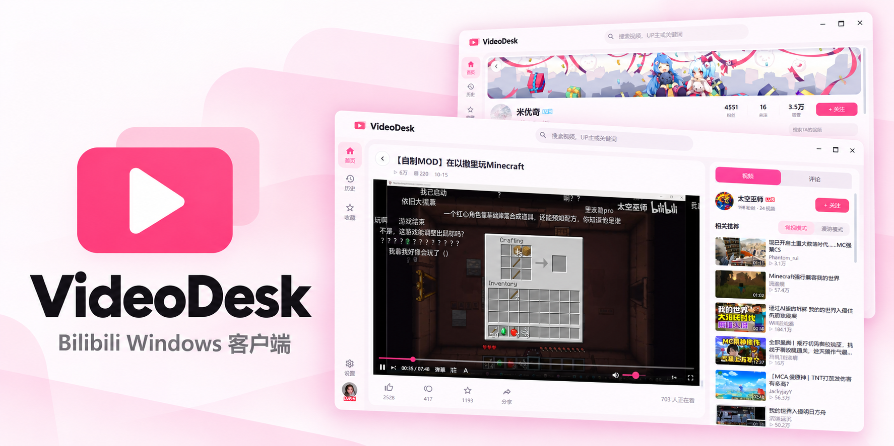

封面与应用图标由 AI 辅助生成。

# VideoDesk

Bilibili Windows 桌面客户端，使用 .NET 10、WPF 和 libmpv 构建。

## 功能特色

- **常规与漫游**：在登录账号的推荐和游客视角之间切换，浏览不同的推荐内容与搜索结果。
- **纯净体验**：简洁的原生界面，不额外加入广告与推送，专注视频、动态和图片浏览。
- **本地数据**：设置、观看进度和图片缓存在本机保存，登录凭据由 Windows DPAPI 加密。

此外还支持热门榜单、搜索、历史记录、收藏，以及浅色／深色主题和界面缩放。

## 开发与运行

### 从源码构建

开发环境为 Windows x64、PowerShell 和 .NET SDK 10.0.401。在项目根目录运行：

```powershell
./scripts/bootstrap.ps1
./scripts/build.ps1
./scripts/build.ps1 -Publish
./scripts/start.ps1
```

`bootstrap.ps1` 根据 [依赖清单](build/dependencies.json) 准备并校验 SDK 和 libmpv，已有依赖会直接复用。发布后的程序位于 `artifacts/app/VideoDesk.exe`，也可以直接打开运行。

NuGet 依赖由各项目的 `packages.lock.json` 锁定，缓存在 `.tools/packages`。需要检查依赖是否与锁文件一致时，可运行 `dotnet restore --locked-mode`。

### 代码目录

| 路径 | 内容 |
| --- | --- |
| `src/VideoDesk.App` | WPF 界面、图片缓存和 libmpv 播放器宿主 |
| `src/VideoDesk.Core` | Bilibili 接口、协议解析、状态和本地存储 |
| `src/VideoDesk.Setup` | 安装器 |
| `tests/VideoDesk.Core.Tests` | 按功能组织的 xUnit 测试 |
| `build` | SDK 和 libmpv 的版本、下载地址及校验值 |
| `scripts` | 准备依赖、构建、启动和打包 |
| `assets` | README 封面等项目展示素材 |
| `artifacts/app` | 可运行程序 |
| `.local` | 登录、设置、观看进度和图片缓存 |
| `.tools`、`.downloads` | 开发依赖和下载缓存 |
| `.reference` | 本地参考源码 |
| `docs`、`designs` | 本地维护笔记与界面参考 |

需要生成压缩包和安装器时，运行 `./scripts/package.ps1`。

### 测试

```powershell
./.tools/dotnet/dotnet.exe test -c Release
```

测试使用模拟 HTTP 和独立临时目录，覆盖协议解析、缓存、评论状态和存储等行为，也可以在 IDE 的测试浏览器中运行。具体范围见 [测试说明](tests/README.md)。

## 数据与诊断

在仓库中运行时，用户数据保存在仓库的 `.local`；单独复制程序后，保存在程序目录下的 `.local`。可用 `--root=<目录>` 设置工作根目录，或用 `--data-root=<目录>` 指定数据目录。

排查问题时，可以添加 `--diagnostics`：HTTP 档案保存在 `captures`，辅助日志保存在数据目录。诊断只对这次启动生效，排查结束后可清理临时档案。

## 许可与免责声明

此项目是个人为了兴趣而开发，仅用于学习和测试，请于下载后24小时内删除。 所用API皆从官方网站收集，不提供任何破解内容。

VideoDesk 是独立开发的第三方客户端，与哔哩哔哩官方无隶属关系。视频、图片、头像、标识与商标的权利归各自权利人所有。

本项目按现状提供，在适用法律允许的范围内不作适用性或持续可用性保证。使用时请遵守平台规则，尊重账号权限与内容授权。

第三方组件和素材按各自许可使用，具体来源与条款见 [第三方许可说明](THIRD-PARTY-NOTICES.md)。

感谢以下项目提供的接口资料与实现参考：

- [bilibili-API-collect](https://github.com/rinnein/bilibili-API-collect)：接口资料与协议说明。
- [PiliPlus](https://github.com/bggRGjQaUbCoE/PiliPlus)：播放、原生评论、稍后再看等功能的实现参考。
- [PiliPala](https://github.com/guozhigq/pilipala)：客户端交互与接口调用参考。

